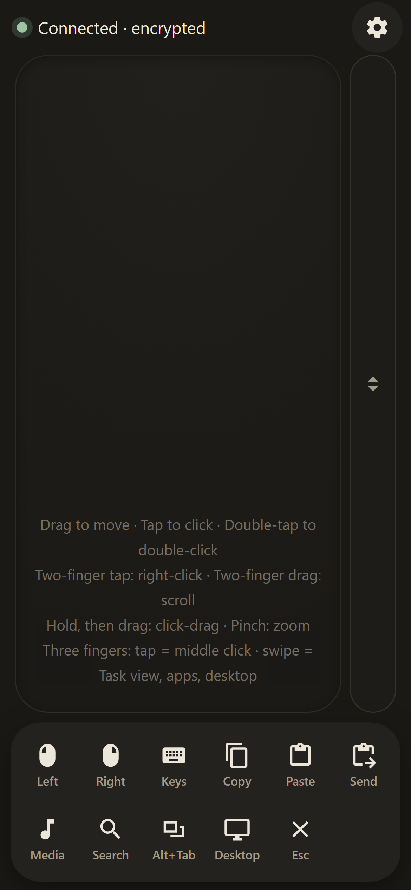
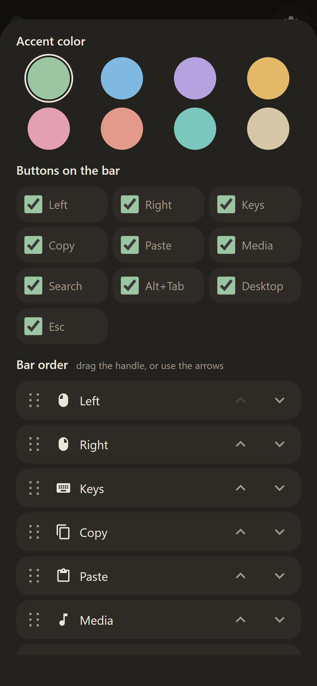

# PhoneMouse

Use your iPhone or iPad as a trackpad and keyboard for your Windows PC over your home network. Move the cursor, click, scroll, type (including accented letters like é ü ñ, and emoji), use shortcuts like Search and Alt+Tab, open Task Manager and shut the PC down, all from Safari on the phone or tablet. You don't need an app.

<p align="center">
  
  &nbsp;&nbsp;
  
</p>

In this guide, "phone" means your iPhone or iPad: both work the same way.

## Requirements

- **Windows** PC (`start.bat` is a Windows script; the Python code may run on macOS or Linux, but that is untested)
- **Python 3.11 or newer** (tested on Python 3.15)
- An **iPhone or iPad** with Safari, connected to the **same home network** as the PC (the PC can be on Wi-Fi or Ethernet)

## What's in the folder

- `server/`: Python server (FastAPI + uvicorn) that moves the mouse and types on the keyboard with pynput
  - `protocol.py`: checks that incoming messages are valid
  - `input_backend.py`: real mouse/keyboard control, plus a dry-run mode that only logs
  - `app.py`: the `/ws` WebSocket endpoint and the web page hosting
  - `__main__.py`: startup (finds the PC's network address and a free port, makes the PIN, prints the banner)
  - `mdns.py`: makes `phonemouse.local` point at this PC, so you don't need the IP address
- `client/`: the web page for the iPhone/iPad (plain HTML/CSS/JS, no build step)
- `PROTOCOL.md`: the messages the phone and the server exchange
- `tests/smoke_test.py`: automated end-to-end test
- `start.bat`: one-click start

## 1. Install

1. Install **Python 3.11+** from <https://www.python.org/downloads/>. During installation, tick **"Add python.exe to PATH"**.
2. Get PhoneMouse onto the PC. Either:
   - on GitHub, click **Code → Download ZIP** and unzip it, for example to `C:\PhoneMouse`, or
   - run `git clone <repository URL> C:\PhoneMouse`.

Avoid very deeply nested folders. Windows has a 260-character path limit, and the Python packages have long file names.

## 2. Start the server

Double-click **`start.bat`**.

It first asks **"Run as administrator…? [Y,N]"**. Answer **Y** (then **Yes** in the Windows prompt) if you want the phone to work in admin windows such as Task Manager, the On-Screen Keyboard and installers; Windows ignores input from a normal program while one of those is in front. Answer **N**, or wait 10 seconds, to run without admin rights. Without them the server logs a warning at startup.

On the first run it creates a `.venv` folder and installs the packages from `requirements.txt` into it. This takes a minute and needs internet. Later runs start straight away. Then it prints something like:

```
==============================================
  PhoneMouse 1.1.0 is running
  Open on iPhone/iPad:  http://phonemouse.local
  Or:                   http://192.168.1.23
  PIN:                  482915
  Or scan with the iPhone/iPad camera:
  (a QR code appears here)
  Press Ctrl+C to stop.
==============================================
```

Open **`http://phonemouse.local`** on the phone. It's the same on every PC and keeps working when the router gives the PC a new IP address. The **Or:** line is the PC's IP address, a backup in case the name doesn't work on your network; that one is different for everyone and PhoneMouse finds it by itself.

PhoneMouse uses port 80, so no port number is needed. If another program already uses port 80, it switches to port 8765 by itself and the addresses end in `:8765`. If a second PC on your network also runs PhoneMouse, that one is called `phonemouse-2.local`. Always use the addresses your window shows.

Keep this window open while you use the phone. The PIN is new every time the server starts.

**To stop:** close the window, or press **Ctrl+C**. If Windows then asks *"Terminate batch job (Y/N)?"*, either answer is fine: the server has already stopped.

Options (add them after `start.bat`, for example `start.bat --port 9000`):
- `--port 9000`: use a specific port (default: 80, or 8765 if 80 is taken)
- `--host 192.168.x.x`: choose which network address to use, if the PC has several
- `--dry-run`: log input instead of moving the real mouse (for testing)

## 3. Allow Python through Windows Firewall (private networks only)

The first time the server starts, Windows usually shows a **"Windows Defender Firewall has blocked some features"** prompt for Python:

1. Tick **Private networks**.
2. Leave **Public networks** unticked.
3. Click **Allow access**.

If you missed the prompt, or the phone can't connect:

1. Open **Start → "Allow an app through Windows Firewall"**.
2. Click **Change settings**, then find **Python** (or `python.exe`). If it isn't listed, use **Allow another app…** and browse to `PhoneMouse\.venv\Scripts\python.exe`.
3. Tick **Private** only, then click **OK**.

Also check that Windows treats your home network as **Private**: **Settings → Network & internet → Wi-Fi** (or **Ethernet**) **→ your network → Network profile type → Private network**.

Instead of the app rule, you can add a rule for just this port. Run this in an **administrator** PowerShell:

```powershell
New-NetFirewallRule -DisplayName "PhoneMouse" -Direction Inbound -Protocol TCP -LocalPort 80,8765 -Profile Private -Action Allow
```

## 4. Open it on the iPhone or iPad

1. Make sure the iPhone or iPad is on the **same Wi-Fi** as the PC (the same router).
2. **Easiest:** open the **Camera** app, point it at the QR code in the PhoneMouse window and tap the link. PhoneMouse opens and connects by itself, no typing.
3. **Or type it:** in Safari, open `http://phonemouse.local` (or the address on the **Or:** line) and enter the 6-digit PIN.

The dot at the top turns **green** when you're connected.

The phone does not save the PIN. Each time you open PhoneMouse, type the PIN shown in the PC window; the server makes a new one every time it starts. While the page stays open, it remembers the PIN in memory: if the phone locks or you switch apps, it reconnects by itself when you come back.

### Gestures

| On the trackpad | Does |
|---|---|
| One-finger drag | Move the cursor. Slow movements are precise; a fast swipe crosses the screen. |
| Tap | Left click |
| Double-tap | Double click |
| Two-finger tap | Right click |
| Two-finger drag | Scroll (natural direction, both axes) |
| Hold for about 0.4 s, then drag | Click-drag: select text, move windows. "Dragging" shows while it's active; lift your finger to release. |

Bottom bar buttons: **Left**, **Right**, **Keys** (opens the on-screen keyboard; tap again to close), **Copy** (Ctrl+C), **Paste** (Ctrl+V), **Media** (opens volume −, mute, volume +, previous, play/pause and next; tap Media again or anywhere else to close), **Search** (Win+S), **Alt+Tab**, **Desktop** (Win+D), **Esc**. Under **Buttons on the bar** in settings, untick the ones you don't need; up to 7 fit in one row, more wrap into two.

The gear icon opens settings for **cursor sensitivity**, **scroll speed**, the **scroll strip** and the **bar buttons**. These are saved on the phone. With the scroll strip turned on, a narrow bar appears to the right of the trackpad: drag one finger up or down on it to scroll.

The settings also have **PC** buttons:
- **Task Manager** opens Task Manager. PhoneMouse must run as administrator: it then starts Task Manager itself, with admin rights, so Windows doesn't ask for your PIN or password. (Ctrl+Shift+Esc would let Windows start it, and if you set User Account Control to ask for a PIN, that prompt can only be answered on the PC.)
- **Shut down PC** asks you to confirm, then shuts the PC down after 5 seconds. The phone counts down 5-4-3-2-1; tap **Cancel** in that message, or **Cancel shutdown**, to stop it.

There is no Ctrl+Alt+Del button: Windows shows that screen on a protected desktop that only accepts a real keyboard and mouse, so the phone could open it but not use it.

## 5. Add to Home Screen (fullscreen app)

1. Open the PhoneMouse page in **Safari**.
2. Tap the **Share** button (at the bottom on iPhone, at the top on iPad), then **Add to Home Screen**, then **Add**.
3. Start PhoneMouse from its icon. It opens fullscreen without the Safari bars.

Add the icon from `http://phonemouse.local`: it keeps working when the PC gets a new IP address. If you added it from the IP address instead and the PC's address changes, add the icon again.

## Troubleshooting

**The page doesn't load on the phone.**
- Check that the `start.bat` window is still open and shows the banner.
- Check that the phone is on the same network, not on mobile data or a guest Wi-Fi. Guest networks usually isolate devices from each other.
- Check the firewall (step 3), including that the network is set to **Private**.
- Type the address exactly as printed, starting with `http://`, not `https://`.
- If `phonemouse.local` doesn't load but the **Or:** address does, your router or network blocks the name lookup (some mesh and guest networks do). Use the IP address; everything else works the same.

**The page loads in a browser on the PC itself, but not on the phone.** The server works, but Windows is blocking connections from other devices. This usually happens on a new PC or after joining a new network, because Windows often sets the network to **Public**. Firewall rules for "Private networks" don't apply on a Public network.
1. In PowerShell, run `Get-NetConnectionProfile` and look at **NetworkCategory**.
2. If it says **Public**, change it: **Settings → Network & internet → Wi-Fi** (or **Ethernet**) **→ your network → Network profile type → Private network**.
3. Reload the page on the phone. You don't need to restart the server.

If it already says **Private**, add the port rule from step 3. A dismissed firewall prompt is remembered as "block".

**The banner shows a strange address, or the wrong one.** If the PC has several network adapters (VPN, virtual machines, Wi-Fi plus Ethernet), the server picks the most likely home address, usually `192.168.x.x`, and lists the others under "Other addresses". Start with the right one: `start.bat --host 192.168.x.x`.

**You use a VPN on the PC.** Many VPN apps block connections from your local network. Look for a setting like "Allow LAN access" or "Invisibility on LAN" and allow local devices. Also see the previous point about the address.

**"Wrong PIN".** Check the 6 digits against the `start.bat` window. **"The PIN on the PC has changed"** means the server was restarted while the page was open: enter the new PIN.

**"Too many wrong PINs".** After 5 wrong attempts, the phone has to wait 60 seconds.

**New buttons or settings don't show after updating PhoneMouse.** The phone is still showing an older saved copy of the page. Open the address in Safari and tap reload once, then add the home-screen icon again.

**Typing does nothing.** First click into a text field on the PC (tap the trackpad), then tap **Keys**.

**The phone stops working after opening Task Manager or the On-Screen Keyboard.** Windows doesn't let normal programs control windows that run as administrator. While such a window is in front, all input from the phone is ignored, until you click another window with the real mouse. Start `start.bat` and answer **Y** to run as administrator. Even then, User Account Control prompts ("Do you want to allow…", or a PIN/password request) and the lock screen can't be controlled remotely: Windows shows them on a protected screen that only accepts the real keyboard and mouse. Use the **Task Manager** button in Settings rather than Ctrl+Shift+Esc to avoid that prompt.

## Security

- The server only listens on your **local network address**, and only accepts connections from local network devices. It isn't reachable from the internet, and you should **not** set up port forwarding for it.
- Every connection needs the PIN, which is random and changes on each start. After 5 wrong PINs from a device, that device is locked out for 60 seconds; after 10 wrong PINs from any devices combined, everyone is locked out for 60 seconds. Wrong PINs are shown in the PhoneMouse window.
- Only PhoneMouse's own page can connect. Other websites open in a browser on your network can't connect to it or guess the PIN in the background, and the page can't be embedded in other sites.
- The connection is unencrypted (`http`/`ws`), which is normal for a home network. Anyone **on your network who knows the current PIN** can control the PC, and someone on the same Wi-Fi with network-sniffing tools could read what you type. Don't run it on public or untrusted Wi-Fi, don't type passwords through it, and close the window when you're done.
- The PhoneMouse window shows the PIN and a QR code that logs in with it. Close or minimise the window before you share your screen or stream.
- Whoever is connected can also shut the PC down. When you run PhoneMouse as administrator (answer **Y** in `start.bat`), the phone can also control admin windows and open Task Manager with admin rights, so only do that on a network you trust.

## Testing

Automated test of the server. It runs in dry-run mode on 127.0.0.1, so your real mouse and keyboard are never touched. Run `start.bat` once first so `.venv` exists, then:

```bat
.venv\Scripts\python.exe tests\smoke_test.py
```

It sends every message type, checks the server executed each one, and checks that wrong or missing PINs, malformed messages and the PIN lockout are rejected.

## Feedback

- **Found a bug?** [Report it](https://github.com/Dizyy/Phonemouse/issues/new?template=bug_report.yml).
- **Want a new feature?** [Suggest it](https://github.com/Dizyy/Phonemouse/issues/new?template=feature_request.yml).
- **Using PhoneMouse?** [Share a review or ask a question](https://github.com/Dizyy/Phonemouse/discussions), and give the repo a ⭐ if you like it.

Please never post your PIN or IP address.

## License

MIT. See [LICENSE](LICENSE).
