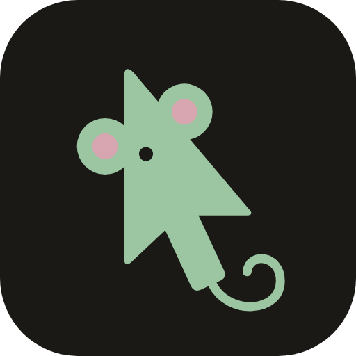
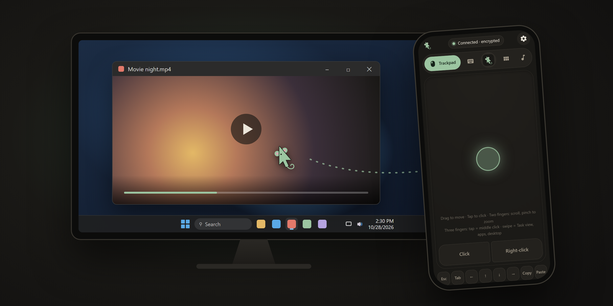
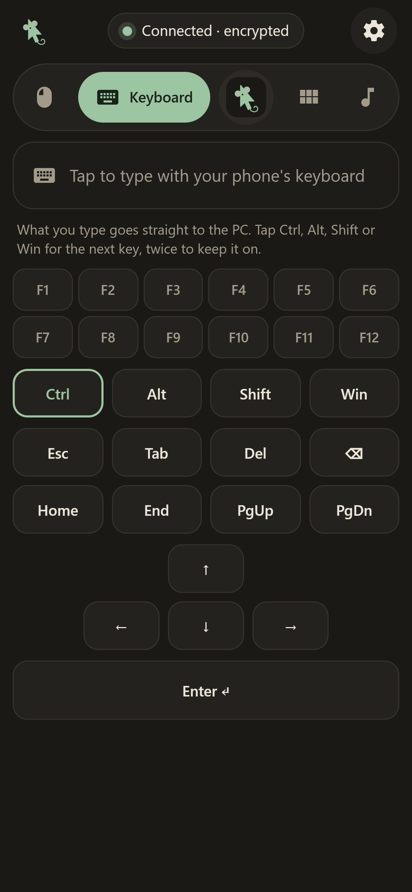
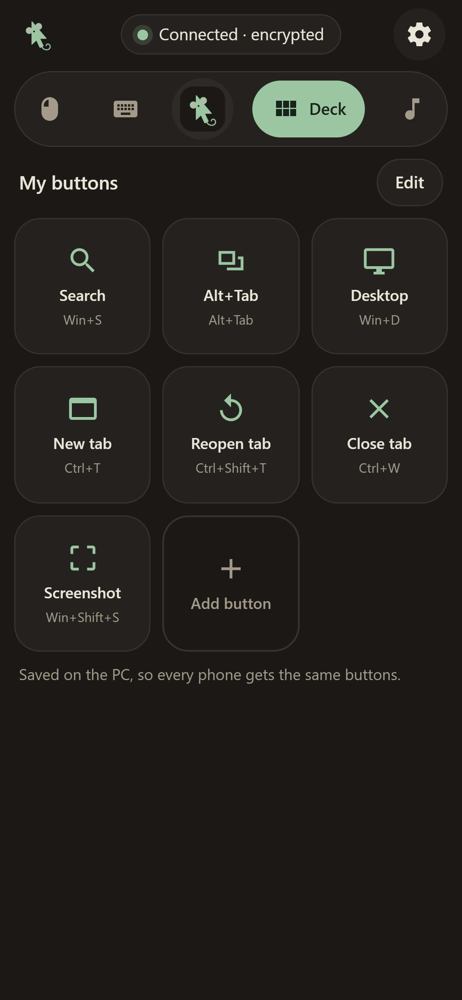
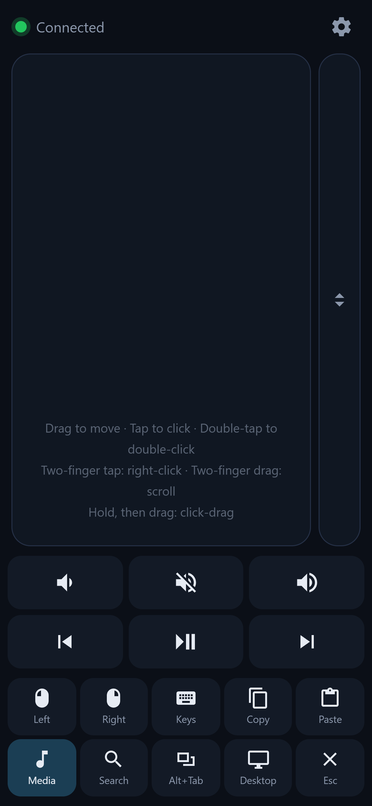
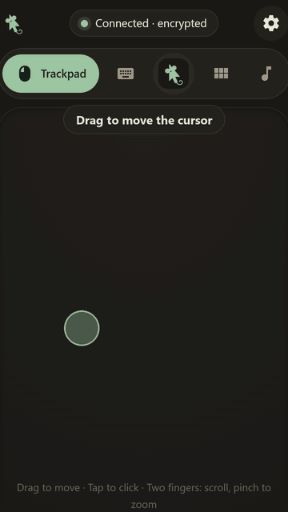
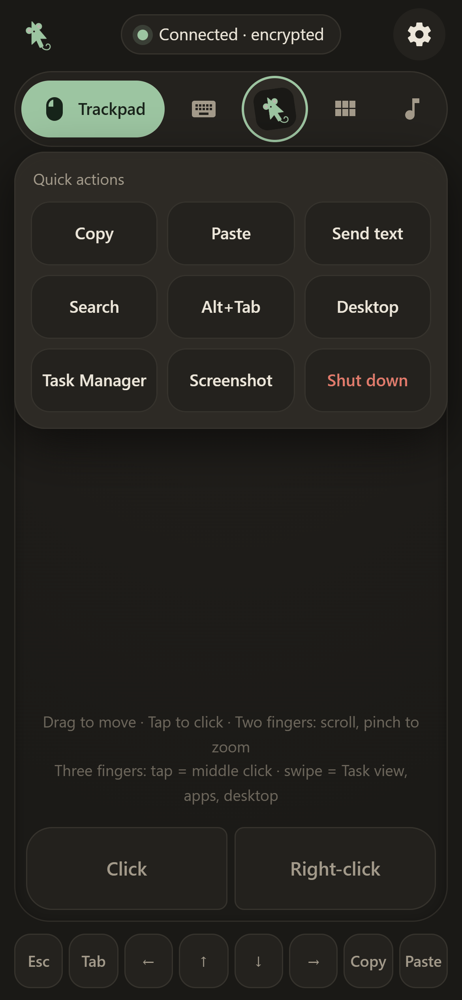
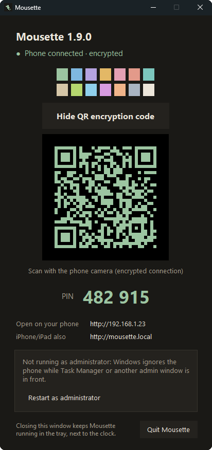

<div align="center">



# Mousette

### Your whole PC in one hand

Trackpad, keyboard, your own buttons and media controls for your Windows PC, on your iPhone, iPad or Android phone.<br>
**Runs in the phone's browser: no app to install, no account, no cloud.**

<br>

<a href="https://github.com/Dizyy/Mousette/releases/latest/download/Mousette.exe"></a>
&nbsp;
<a href="#security"></a>

<br>

[](https://github.com/Dizyy/Mousette/releases/latest)
[](#what-works-where)
[](#1-download)
[](LICENSE)

<br>



</div>

<br>

<table>
<tr>
<td width="33%" align="center" valign="top">

**1. Download `Mousette.exe`**<br>
<sub>One file, no installer. Double-click to start.</sub>

</td>
<td width="33%" align="center" valign="top">

**2. Scan the QR code**<br>
<sub>With your phone's camera. It connects encrypted.</sub>

</td>
<td width="33%" align="center" valign="top">

**3. Add to Home Screen**<br>
<sub>It then opens fullscreen, like an app.</sub>

</td>
</tr>
</table>

## Four tabs, one hand

<table>
<tr>
<td width="50%" align="center" valign="top">


**Trackpad**<br>
<sub>Windows gestures: two-finger scroll that keeps gliding, pinch to zoom, three- and four-finger swipes for Task view, apps and desktops. Big Click and Right-click buttons under your thumb.</sub>

</td>
<td width="50%" align="center" valign="top">



**Keyboard**<br>
<sub>Type in any language with your phone's keyboard. F1–F12, arrows, and sticky Ctrl, Alt, Shift and Win: tap Ctrl, then C, for Ctrl+C.</sub>

</td>
</tr>
<tr>
<td width="50%" align="center" valign="top">



**Deck**<br>
<sub>Your own buttons: a shortcut, a piece of text, a website or an app, with your own name, icon and colour. Saved on the PC, so every phone gets them.</sub>

</td>
<td width="50%" align="center" valign="top">



**Media**<br>
<sub>Play/pause, next and previous track, rewind and forward, fullscreen and volume, for music and videos on the PC.</sub>

</td>
</tr>
</table>

<p align="center">
  
  &nbsp;&nbsp;
  
</p>
<p align="center"><sub>Left: the gestures. Right: <b>Quick actions</b>, one tap on the little mouse in the tab bar.</sub></p>

## Made for real life

- **Movie night:** the laptop is on the TV and you're on the couch. Play, pause, skip back, go fullscreen and turn it down without getting up.
- **Presenting:** next and previous slide with the arrows, F5 to start the show, and a Deck button that opens your slides.
- **PC on the TV:** browse, search and type on the big screen with a real trackpad and keyboard in your hand.
- **Couch gaming:** start a game from the couch, Alt+Tab out to change a setting, turn the volume up, then pick up the controller.
- **Across the desk:** when the PC is out of reach, or the mouse is on the other side of a stack of books.

## Why Mousette?

A program that controls your mouse and keyboard has to be one you can trust. Many remote mouse apps are closed source, keep a background service running after you close them, and send data you can't check. Mousette works differently:

- **Open source (AGPL-3.0):** every line of the PC program and the phone page is in this repo, and every changed copy someone shares has to stay open source too.
- **Nothing left running:** **Quit Mousette** stops it completely. It doesn't start with Windows and installs no service.
- **No tracking:** no accounts, no ads, no analytics. The only internet request is the update check on GitHub at start, which you can turn off with `--no-update`.
- **Stays on your home network:** the phone talks straight to your PC. Nothing goes through a cloud server, and the phone page loads nothing from the internet.
- **Encrypted:** scan the QR code and everything between the phone and the PC is encrypted: the PIN, every tap, everything you type or paste. Others on your Wi-Fi can't read it, and recorded traffic can't be replayed.
- **PIN protected:** a new random PIN on every start, and devices that guess wrong get locked out (see [Security](#security)).
- **No phone app:** it runs in the phone's browser, so there's nothing to install from an app store.

### How it compares

| | **Mousette** | Remote Mouse | KDE Connect | CmdPalm |
|---|---|---|---|---|
| On the phone | Browser, no app | App from the app store | App from the app store | Browser, no app |
| On the computer | Windows | Windows, Mac | Linux, Windows, Mac | Mac only |
| Open source | Yes (AGPL) | No | Yes (GPL) | Yes (AGPL) |
| Price | Free | Free, with paid extras | Free | Free |
| Your own buttons | Yes (Deck) | Yes | Run commands | Yes |
| Account needed | No | No | No | No |

<sub>From each project's own pages, October 2026. Something changed? [Tell us](https://github.com/Dizyy/Mousette/discussions).</sub>

## Features

- **Quick to connect:** scan the QR code in the Mousette window with the phone camera.
- **Encrypted connection:** the QR code gives the phone a secret key, and everything sent between the phone and the PC is encrypted with keys made from it (XSalsa20-Poly1305 from the NaCl library). The key reaches the phone through the camera, never over the network, and the phone stays paired after the PC restarts. Typing the PIN by hand connects without encryption, and the page tells you so. Details: [PROTOCOL.md](PROTOCOL.md#encryption).
- **Trackpad with Windows gestures:** tap to click, two-finger tap to right-click, two-finger scroll that keeps gliding after a flick, pinch to zoom, three-finger tap to middle-click, three- and four-finger swipes for Task view, the app switcher, Show desktop and virtual desktops, hold and drag to select or move windows. Or scroll with one finger on the scroll strip next to the trackpad (turn it on or off in settings).
- **Keyboard:** type in any language, including é ü ñ and emoji, or paste text from your phone onto the PC. F1–F12, arrows, Home/End, and sticky Ctrl, Alt, Shift and Win for any shortcut.
- **Your own buttons (Deck):** make buttons for a keyboard shortcut, a piece of text to paste, a website or an app, with your own name, icon and colour. They're saved on the PC, so every phone gets the same buttons.
- **Quick actions and media:** Copy, Paste, Search, Alt+Tab, Task Manager, Screenshot, shut down; play/pause, next track, volume.
- **Your layout:** 14 accent colors, the tab bar at the top or bottom, and you pick which shortcut keys the Trackpad tab shows and in what order.

## What works where

| | Status |
|---|---|
| **Windows** PC | Tested |
| **iPhone / iPad** (Safari) | Tested |
| **Android** (Chrome and other browsers) | Tested. Use the IP address or the QR code: Android can't open `mousette.local`. |
| **macOS** | Should work, not tested yet. Needs the Accessibility permission (see [macOS and Linux](#macos-and-linux)). |
| **Linux** | Should work on X11, not tested yet. Wayland is not supported. |

The phone and the PC must be on the **same home network** (the PC can be on Wi-Fi or Ethernet). If you try it on macOS or Linux, please [tell us how it went](https://github.com/Dizyy/Mousette/discussions).

## What's in the folder

- `server/`: Python server (FastAPI + uvicorn) that moves the mouse and types on the keyboard with pynput
  - `protocol.py`: checks that incoming messages are valid
  - `input_backend.py`: real mouse/keyboard control, plus a dry-run mode that only logs
  - `app.py`: the `/ws` WebSocket endpoint and the web page hosting
  - `__main__.py`: startup (finds the PC's network address and a free port, makes the PIN, prints the banner)
  - `tray.py`: the window and tray icon of `Mousette.exe` on Windows
  - `mdns.py`: makes `mousette.local` point at this PC, so you don't need the IP address
  - `update.py`: checks GitHub for a new version when Mousette starts, and installs it
  - `clipboard.py`: puts text from the phone on the PC clipboard
  - `deck.py`: saves the phone's own Deck buttons on the PC (`deck.json` next to the encryption key)
  - `encryption.py`: the encryption key and encrypted connections (PyNaCl)
- `client/`: the web page for the phone (plain HTML/CSS/JS, no build step); `client/vendor/` holds [tweetnacl.js](https://github.com/dchest/tweetnacl-js) 1.0.3 (public domain) for encryption
- `PROTOCOL.md`: the messages the phone and the server exchange
- `tests/`: automated tests
- `start.bat` / `start.sh`: one-click start from source (Windows / macOS and Linux)
- `uninstall.bat`: removes the source version from a Windows PC
- `mousette.py`, `build.py`: entry point and build script for the single-file `Mousette.exe`

## 1. Download

**Windows (easiest):** download **`Mousette.exe`** from the [latest release](https://github.com/Dizyy/Mousette/releases/latest) and put it in any folder, for example your Documents. That's all: no Python, no installer.

Windows may show **"Windows protected your PC"** the first time, because Mousette isn't signed with a code signing certificate yet. Click **More info → Run anyway**.

On Windows 11 with **Smart App Control** turned on, Windows may block `Mousette.exe` without a **Run anyway** button. Use the source version below instead. Signing `Mousette.exe` is planned.

**From source** (Windows, macOS, Linux):
1. Install **Python 3.11+** from <https://www.python.org/downloads/>. On Windows, tick **"Add python.exe to PATH"** during installation.
2. On GitHub, click **Code → Download ZIP** and unzip it, for example to `C:\Mousette`, or run `git clone https://github.com/Dizyy/Mousette.git`.

On Windows, avoid very deeply nested folders: Windows has a 260-character path limit, and the Python packages have long file names.

## 2. Start it

**`Mousette.exe`:** double-click it. The Mousette window opens and shows:
- the QR code (click **Show QR encryption code**: it holds the encryption key, so it stays hidden until you ask) and the PIN
- the addresses to open on the phone
- whether a phone is connected, and whether the connection is encrypted

<p align="center">
  
</p>

Mousette also puts its icon in the tray, next to the clock (click **^** if you don't see it). Closing the window keeps Mousette running there; click the icon to show the window again. Right-click it for **Show Mousette**, **Restart as administrator**, **Open log** and **Quit Mousette**. Starting `Mousette.exe` again just brings the window back.

To control admin windows such as Task Manager, the On-Screen Keyboard and installers, click **Restart as administrator** in the window or the tray menu, then **Yes** in the Windows prompt. Windows ignores input from a normal program while one of those is in front.

**From source:** double-click **`start.bat`** on Windows, or run `bash start.sh` on macOS and Linux. On Windows it first asks **"Run as administrator…?"**: answer **Y** (then **Yes** in the Windows prompt) for admin windows, or **N** (or wait 10 seconds) to run without admin rights. The first run creates a `.venv` folder and installs the packages from `requirements.txt` into it. This takes a minute and needs internet. Later runs start straight away. The source version runs in a console window and prints something like:

```
==============================================
  Mousette 1.9.0 is running
  Open on your phone:    http://192.168.1.23
  iPhone/iPad also:      http://mousette.local
  PIN:                  482915
  Or scan with the phone camera (encrypted connection):
  (a QR code appears here)
  Press Ctrl+C to stop.
==============================================
```

Scan the QR code with the phone (step 4), or open the address from **Open on your phone**: that's the PC's IP address, it works on every phone, and Mousette finds it by itself. On iPhone and iPad you can also use **`http://mousette.local`**: it's the same on every PC and keeps working when the router gives the PC a new IP address. When you scan the QR code with an iPhone or iPad, Mousette moves over to `mousette.local` by itself (if your network allows it). Android phones can't open `.local` names, so use the IP address there.

Mousette uses port 80, so no port number is needed. If another program already uses port 80, it switches to port 8765 by itself and the addresses end in `:8765`. If a second PC on your network also runs Mousette, that one is called `mousette-2.local`. Always use the addresses your window shows.

Keep Mousette running while you use the phone. The PIN is new every time Mousette starts.

**To stop:** `Mousette.exe`: click **Quit Mousette** in the window, or right-click the tray icon and choose **Quit Mousette**. From source: close the window, or press **Ctrl+C**. If Windows then asks *"Terminate batch job (Y/N)?"*, either answer is fine: Mousette has already stopped.

Options (add them after the command, for example `start.bat --port 9000`, or `Mousette.exe --port 9000` in a command prompt or in a shortcut's **Target** field):
- `--port 9000`: use a specific port (default: 80, or 8765 if 80 is taken)
- `--host 192.168.x.x`: choose which network address to use, if the PC has several
- `--dry-run`: log input instead of moving the real mouse (for testing)
- `--no-update`: don't check for a new version this time
- `--new-key`: make a new encryption key, so every phone has to scan the QR code again (see [Security](#security))

## 3. Allow Mousette through the firewall (private networks only)

The first time Mousette starts, Windows usually shows a **"Windows Defender Firewall has blocked some features"** prompt for Mousette (or Python, when you run from source):

1. Tick **Private networks**.
2. Leave **Public networks** unticked.
3. Click **Allow access**.

If you missed the prompt, or the phone can't connect:

1. Open **Start → "Allow an app through Windows Firewall"**.
2. Click **Change settings**, then find **Mousette** (or **Python** / `python.exe` from source). If it isn't listed, use **Allow another app…** and browse to `Mousette.exe` (from source: `Mousette\.venv\Scripts\python.exe`).
3. Tick **Private** only, then click **OK**.

Also check that Windows treats your home network as **Private**: **Settings → Network & internet → Wi-Fi** (or **Ethernet**) **→ your network → Network profile type → Private network**.

Instead of the app rule, you can add rules for just Mousette's ports: TCP for the page, and UDP 5353 so the phone can find `mousette.local`. Run this in an **administrator** PowerShell:

```powershell
New-NetFirewallRule -DisplayName "Mousette" -Direction Inbound -Protocol TCP -LocalPort 80,8765 -Profile Private -Action Allow
New-NetFirewallRule -DisplayName "Mousette" -Direction Inbound -Protocol UDP -LocalPort 5353 -Profile Private -Action Allow
```

### macOS and Linux

- **macOS:** the first time the phone moves the mouse, macOS asks to allow **Accessibility** access for Terminal (or the app you started `start.sh` from). Allow it under **System Settings → Privacy & Security → Accessibility**, then restart Mousette. Port 80 needs admin rights on some systems; Mousette then uses 8765 by itself.
- **Linux:** works with X11 desktops. On Wayland (the default on many new systems), apps aren't allowed to move the mouse, so Mousette can't work there; choose an X11 session at login instead. Pasting from the phone needs `xclip`, `xsel` or `wl-clipboard` installed. If a firewall like `ufw` is on, allow the port: `sudo ufw allow 8765/tcp`.
- **Shut down PC** asks the system to shut down after 5 seconds; **Task Manager** opens Activity Monitor (macOS) or the system monitor (Linux).

## 4. Open it on the phone

1. Make sure the phone is on the **same Wi-Fi** as the PC (the same router).
2. **Easiest, and encrypted:** open the **Camera** app (on Android, the camera, or **Google Lens** if the camera doesn't react), click **Show QR encryption code** in the Mousette window, point the camera at the QR code and tap the link. Mousette opens and connects by itself, no typing, and the connection is encrypted.
3. **Or type it:** in the browser (Safari on iPhone/iPad, Chrome on Android), open the address from **Open on your phone** (on iPhone/iPad also `http://mousette.local`) and enter the 6-digit PIN. This connects **without** encryption; scan the QR code once to encrypt it.

The dot at the top turns **green** when you're connected, and it says **Connected · encrypted** when the connection is encrypted.

You only type the PIN once per server start. After that the phone stays logged in: if you lock and unlock it, switch apps, or close and reopen Mousette, it reconnects by itself. When the server restarts, it makes a new PIN and the phone asks for it again.

### Gestures

| On the trackpad | Does |
|---|---|
| One-finger drag | Move the cursor. Slow movements are precise; a fast swipe crosses the screen. |
| Tap | Left click |
| Double-tap | Double click |
| Two-finger tap | Right click |
| Two-finger drag | Scroll (natural direction, both axes). Flick and let go: it keeps scrolling and slows down. |
| Pinch (two fingers apart or together) | Zoom (Ctrl + mouse wheel): browsers, Office, photos, maps |
| Three-finger tap | Middle click: open a link in a new tab, close a tab |
| Three-finger swipe up / down | Task view / Show desktop |
| Three-finger swipe left or right | Opens the app switcher; keep sliding to pick an app, lift to open it |
| Four-finger tap | Notifications |
| Four-finger swipe left / right | Next / previous virtual desktop (up / down as with three fingers) |
| Hold for about 0.4 s, then drag | Click-drag: select text, move windows. "Dragging" shows while it's active; lift your finger to release. |

### The tabs

The tab bar has **Trackpad**, **Keyboard**, **Deck** and **Media**, with the little mouse in the middle for **Quick actions**.

- **Trackpad:** the pad with **Click** and **Right-click** under it, and a row of small shortcut keys (Esc, Tab, arrows, Copy, Paste). In settings, under **Shortcut keys**, put the row at the **Top** or **Bottom** or turn it **Off**, untick keys you don't need, and drag them by the handle (or use the arrows) to change the order. **Reset shortcut keys** brings them all back.
- **Keyboard:** tap the box at the top to open your phone's keyboard; tap it again to close it. Below it are **F1–F12**, **Ctrl**, **Alt**, **Shift** and **Win**, Esc, Tab, Del, Backspace, Home, End, PgUp, PgDn, the arrows and Enter.
  - Tap **Ctrl**, **Alt**, **Shift** or **Win** and it's held for the next key only (outlined), so **Ctrl** then **C** is Ctrl+C. Letters typed on the phone keyboard work too.
  - Tap it twice quickly to keep it on (filled, with a small bar), for example **Ctrl** with several arrow presses. Tap it once more to turn it off.
  - The held keys also apply to the shortcut keys on the Trackpad tab.
- **Deck:** your own buttons. Tap **Edit**, then **Add button**, and choose what it does: a **shortcut** (pick Ctrl/Alt/Shift/Win and a key), **text** to paste (optionally pressing Enter after it), a **website** to open in the PC's browser, or an **app** to open through Windows search. Give it a name, an icon and a colour. In Edit mode, tap a button to change or delete it, and hold one, then drag it to move it. The buttons are saved on the PC, so every phone that connects gets the same Deck. Until you change it, the Deck shows a few useful shortcuts.
- **Media:** previous, play/pause and next, rewind and forward (the arrow keys, which most video players use), fullscreen (F) and volume down, mute and up.
- **Quick actions:** tap the little mouse in the middle of the tab bar for **Copy**, **Paste**, **Send text**, **Search** (Win+S), **Alt+Tab**, **Desktop** (Win+D), **Task Manager**, **Screenshot** (Win+Shift+S) and **Shut down**. Tap anywhere else to close it.

**Send text from your phone:** copy something on the phone, tap the little mouse, then **Send text**, paste it into the box and tap **Paste on PC**. It's pasted where the cursor is on the PC, in one go, line breaks included. You can also paste while the phone keyboard is open on the Keyboard tab (for example from the keyboard's clipboard on Android): it's pasted on the PC the same way.

The gear icon opens settings for **cursor sensitivity**, **scroll speed**, the **scroll strip**, the **accent color**, the **tab bar** (top or bottom) and the **shortcut keys**. These are saved on the phone. The accent color also colors the QR code in the Mousette window, and the color dots above **Show QR encryption code** change it on the phone: the PC and the phone always match. With the scroll strip turned on, a narrow bar appears to the right of the trackpad: drag one finger up or down on it to scroll.

The settings also have **PC** buttons:
- **Task Manager** opens Task Manager. Mousette must run as administrator: it then starts Task Manager itself, with admin rights, so Windows doesn't ask for your PIN or password. (Ctrl+Shift+Esc would let Windows start it, and if you set User Account Control to ask for a PIN, that prompt can only be answered on the PC.)
- **Shut down PC** asks you to confirm, then shuts the PC down after 5 seconds. The phone counts down 5-4-3-2-1; tap **Cancel** in that message, or **Cancel shutdown**, to stop it.

There is no Ctrl+Alt+Del button: Windows shows that screen on a protected desktop that only accepts a real keyboard and mouse, so the phone could open it but not use it.

## 5. Add to Home Screen (fullscreen app)

1. Open the Mousette page in **Safari** (iPhone/iPad) or **Chrome** (Android). On iPhone/iPad, open it by scanning the QR code: the icon then keeps the encryption key, and the app only asks for the PIN.
2. iPhone/iPad: tap the **Share** button (at the bottom on iPhone, at the top on iPad), then **Add to Home Screen**, then **Add**. Android: tap the **⋮** menu, then **Add to Home screen**.
3. Start Mousette from its icon. It opens fullscreen without the browser bars.

The page shows a short tip about this the first few times you open it in the browser.

On iPhone/iPad, add the icon from `http://mousette.local`: it keeps working when the PC gets a new IP address. An icon added from the IP address (always the case on Android) stops working if the PC's address changes; then add it again. Most home routers keep giving the PC the same address.

## Updates

Each time Mousette starts, it checks GitHub for a new version. If there is one, it downloads it and restarts itself, which takes a few seconds: `Mousette.exe` replaces itself, and the source version replaces its files. Your settings on the phone and the `.venv` folder are kept. Without internet it just starts the version you have.

To skip the check once, start it with `--no-update`. A folder made with `git clone` is never updated automatically; run `git pull` there instead.

Versions before 1.2.0 can't update themselves: download the latest version once (step 1), and later versions arrive by themselves.

Mousette used to be called CouchPad, and before that PhoneMouse. PhoneMouse 1.2.0 and later, and every CouchPad, update to Mousette by themselves. After the update, scan the QR code in the Mousette window once and add the home-screen icon again: the old `couchpad.local` and `phonemouse.local` addresses stop working.

## Uninstall

**`Mousette.exe`:** quit it (tray icon → **Quit Mousette**), then delete the file (and `Mousette.exe.old` next to it, if there is one), and the folder `%APPDATA%\Mousette` with the encryption key and log. If you allowed it through the firewall in step 3, remove that entry under **Start → "Allow an app through Windows Firewall"**. On the phone, remove the home-screen icon.

**From source on Windows:**

1. Double-click **`uninstall.bat`** in the Mousette folder and answer **Yes** in the Windows prompt.
2. Press **Y** to confirm. It stops Mousette, removes the `Mousette` firewall rule if you added one in step 3, and deletes the whole Mousette folder.
3. On the phone, press and hold the Mousette icon and remove it.

If you ticked **Allow access** for Python in step 3, that firewall entry belongs to your Python installation and stays. Remove it under **Start → "Allow an app through Windows Firewall"** if you no longer want it. Python itself stays installed too.

## Troubleshooting

**The page doesn't load on the phone, or stays black.**
- If you started a new copy of `Mousette.exe` from another folder, Windows treats it as a new program and blocks it until you allow it (step 3). Its prompt can hide behind other windows.
- Check that Mousette is still running: its icon is in the tray (from source: the window still shows the banner).
- Check that the phone is on the same network, not on mobile data or a guest Wi-Fi. Guest networks usually isolate devices from each other.
- Check the firewall (step 3), including that the network is set to **Private**.
- Type the address exactly as the Mousette window shows it, starting with `http://`, not `https://`.
- On Android, `mousette.local` never loads (`DNS_PROBE_FINISHED_NXDOMAIN`): Android browsers can't open `.local` names. Use the IP address or the QR code.
- If `mousette.local` doesn't load on an iPhone but the IP address does, your router or network blocks the name lookup (some mesh and guest networks do), or the firewall blocks UDP port 5353 (see step 3). Use the IP address; everything else works the same.

**It reconnects after a short lock, but not after a longer one.** After a longer sleep the phone looks up `mousette.local` again. Mousette then reconnects through the PC's IP address by itself; if the page itself was reloaded and Safari can't open it, wait up to 30 seconds and reload. For a permanent fix, allow UDP port 5353 in the firewall (step 3).

**The page loads in a browser on the PC itself, but not on the phone.** The server works, but Windows is blocking connections from other devices. This usually happens on a new PC or after joining a new network, because Windows often sets the network to **Public**. Firewall rules for "Private networks" don't apply on a Public network.
1. In PowerShell, run `Get-NetConnectionProfile` and look at **NetworkCategory**.
2. If it says **Public**, change it: **Settings → Network & internet → Wi-Fi** (or **Ethernet**) **→ your network → Network profile type → Private network**.
3. Reload the page on the phone. You don't need to restart the server.

If it already says **Private**, add the port rule from step 3. A dismissed firewall prompt is remembered as "block".

**The window shows a strange address, or the wrong one.** If the PC has several network adapters (VPN, virtual machines, Wi-Fi plus Ethernet), the server picks the most likely home address, usually `192.168.x.x`, and lists the others under "Other addresses". Start with the right one: `--host 192.168.x.x` (see the options in step 2).

**You use a VPN on the PC.** Many VPN apps block connections from your local network. Look for a setting like "Allow LAN access" or "Invisibility on LAN" and allow local devices. Also see the previous point about the address.

**Where's the log?** `Mousette.exe`: right-click the tray icon → **Open log**. It's the file `%APPDATA%\Mousette\mousette.log`. From source, everything is in the console window.

**"Wrong PIN".** Check the 6 digits against the Mousette window. **"Mousette on the PC was restarted"** or **"The PIN on the PC has changed"** means the server was restarted: enter the new PIN.

**"Too many wrong PINs".** After 5 wrong attempts, the phone has to wait 60 seconds.

**New buttons or settings don't show after updating Mousette.** The phone is still showing an older saved copy of the page. Open the address in the browser and tap reload once, then add the home-screen icon again.

**Typing does nothing.** First click into a text field on the PC (tap the trackpad), then open the **Keyboard** tab and tap the box at the top.

**The phone stops working after opening Task Manager or the On-Screen Keyboard.** Windows doesn't let normal programs control windows that run as administrator. While such a window is in front, all input from the phone is ignored, until you click another window with the real mouse. Click **Restart as administrator** in the Mousette window (from source: answer **Y** when `start.bat` starts). Even then, User Account Control prompts ("Do you want to allow…", or a PIN/password request) and the lock screen can't be controlled remotely: Windows shows them on a protected screen that only accepts the real keyboard and mouse. Use the **Task Manager** button in Settings rather than Ctrl+Shift+Esc to avoid that prompt.

## Security

- The server only listens on your **local network address**, and only accepts connections from local network devices. It isn't reachable from the internet, and you should **not** set up port forwarding for it.
- Every connection needs the PIN, which is random and changes on each start. After the PIN, the phone saves a random login token so it can reconnect after being locked; the token stops working when the server restarts. After 5 wrong PINs from a device, that device is locked out for 60 seconds; after 10 wrong PINs from any devices combined, everyone is locked out for 60 seconds. Wrong PINs are logged: in the console window from source, in `%APPDATA%\Mousette\mousette.log` for `Mousette.exe`.
- Only Mousette's own page can connect. Other websites open in a browser on your network can't connect to it or guess the PIN in the background, and the page can't be embedded in other sites.
- **Encryption:** when you connect by scanning the QR code, everything between the phone and the PC is encrypted, including the PIN and everything you type or paste. Someone else on your Wi-Fi can't read it, and recorded traffic can't be replayed. The QR code carries a secret key that never travels over the network. The phone keeps it, so it stays encrypted after the PC restarts (you still enter the new PIN). If you **type** the PIN instead of scanning, the connection is **not** encrypted, and the page tells you so: someone on the same Wi-Fi with network-sniffing tools could then read what you type. Details: [PROTOCOL.md](PROTOCOL.md#encryption).
- The key is saved on the PC (`%APPDATA%\Mousette\key` on Windows). To unpair all phones, start Mousette with `--new-key` and scan the new QR code.
- Don't run Mousette on public or untrusted Wi-Fi, and quit Mousette when you're done. Anyone **on your network who knows the current PIN** can control the PC.
- Text you send with **Send text** goes onto the PC clipboard. On Windows it is marked so it stays out of clipboard history (Win+V) and isn't synced to your other devices through the cloud clipboard. It stays on the clipboard itself until you copy something else.
- The Mousette window shows the PIN and a QR code that logs in with it and carries the encryption key. Close or minimise the window before you share your screen or stream (`Mousette.exe` keeps running in the tray).
- Whoever is connected can also shut the PC down. When you run Mousette as administrator, the phone can also control admin windows and open Task Manager with admin rights, so only do that on a network you trust.

## Testing

Automated test of the server. It runs in dry-run mode on 127.0.0.1, so your real mouse and keyboard are never touched. Run `start.bat` (or `start.sh`) once first so `.venv` exists, then:

```bat
.venv\Scripts\python.exe tests\smoke_test.py
```

It sends every message type, checks the server executed each one, and checks that wrong or missing PINs, malformed messages and the PIN lockout are rejected. It also checks the connected-phone status that the Mousette window shows.

The updater has its own test, which needs no network:

```bat
.venv\Scripts\python.exe tests\update_test.py
```

## Building Mousette.exe

```bat
.venv\Scripts\python.exe build.py
```

It installs [PyInstaller](https://pyinstaller.org/), Pillow (for the icon) and, on Windows, pystray (for the tray icon) into `.venv`, which are only needed for building, and writes `dist\Mousette.exe`. Attach that file to each GitHub release with exactly that name: the .exe updater downloads it from there. On macOS or Linux the same command builds `dist/Mousette` for that system.

## Feedback

- **Found a bug?** [Report it](https://github.com/Dizyy/Mousette/issues/new?template=bug_report.yml).
- **Want a new feature?** [Suggest it](https://github.com/Dizyy/Mousette/issues/new?template=feature_request.yml).
- **Using Mousette?** [Share a review or ask a question](https://github.com/Dizyy/Mousette/discussions), and give the repo a ⭐ if you like it.

Please never post your PIN or IP address.

## License

Copyright (c) 2026 Dizyy. Mousette is free software under the [GNU Affero General Public License v3.0](LICENSE) (AGPL-3.0): you may use, change and share it, and if you share a changed version, or let others use it over a network, you must publish its source code under the same license.

Versions up to 1.9.0 were released under the MIT license.
